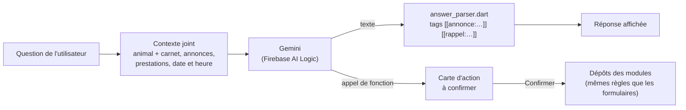

# Assistant IA PetCare

Ce document décrit l'assistant IA de PetCare tel qu'il est dans `main` (novembre 2026), venu de la branche
`chatbot`. La place de l'IA dans tout le projet est résumée dans [reflexion.md](reflexion.md#8-utilisation-de-lia).

---

## 1. Fonctionnalités

- **Accès** : carte de l'assistant sur l'Accueil, bannière du fil d'adoption, et bouton « Conseils » de la fiche d'un
  animal, qui ouvre l'assistant avec cet animal déjà sélectionné (route `AppRoutes.assistant`).
- **Visiteur** : questions générales sur les animaux et suggestions d'animaux à adopter, présentées sous forme de
  cartes vers les annonces réelles.
- **Membre connecté** :
  - choix d'un de ses animaux : la fiche (espèce, âge, poids, notes) et un résumé du carnet de santé (allergies,
    derniers vaccins, traitements en cours, dernière visite) sont joints à la question ;
  - questions recommandées selon l'animal ;
  - conseils santé structurés : niveau d'urgence, gestes sûrs, ce qu'il faut surveiller ;
  - en cas d'urgence, la réponse commence par « ⚠️ Urgence : contactez immédiatement un vétérinaire » ;
  - « Créer un rappel » depuis une réponse ;
  - historique des 10 dernières conversations, avis 👍 / 👎, copie d'une réponse ;
  - limite de 30 messages par jour.
- **Actions préparées par l'assistant** : ajouter un soin au carnet, ajouter un traitement, créer un rendez-vous
  personnel, réserver un service chez un prestataire PetCare, ajouter une pesée, créer un rappel. L'assistant affiche
  une **carte à vérifier**, et rien n'est enregistré avant « Confirmer ». L'enregistrement passe par les mêmes
  dépôts que les formulaires (`HealthRepository`, `AppointmentRepository`, `ServiceRepository`, `PetRepository`…) :
  mêmes contrôles, mêmes règles Firestore.
- **« Rédiger avec l'IA »** dans le formulaire d'annonce d'adoption : description de 3 à 5 phrases écrite à partir
  des seuls champs remplis.

## 2. Fonctionnement technique

- **Modèle** : Gemini `gemini-3.5-flash-lite` par **Firebase AI Logic** (paquet `firebase_ai`, Gemini Developer API).
  Il est gratuit sur le plan Spark et ne demande **aucune clé d'API dans l'application**.
- **Trois configurations du même modèle** : conversation (température 0,4), conversation avec fonctions pour les
  membres connectés (température 0,2, réponses plus stables) et rédaction d'annonce (température 0,7, plus
  créative). Les réponses sont limitées en longueur.
- **Consignes système** (`assistant_prompt.dart`) :
  - français, vouvoiement, réponses courtes ;
  - sujets limités aux animaux et à PetCare ;
  - jamais de diagnostic certain, ni de nom ou de dose de médicament, ni de médicament humain ;
  - liste des signes d'urgence ;
  - jamais d'animal ni de prestataire inventé : l'assistant ne propose que les annonces et les prestations fournies,
    citées par leur identifiant ;
  - aucune valeur inventée pour une action : si une information manque (heure, date de rappel, posologie), il pose
    une question.
- **Fonctions** (`assistant_actions.dart`) : `ajouter_soin`, `ajouter_traitement`, `creer_rendez_vous`,
  `reserver_service`, `ajouter_pesee`, `creer_rappel`. Si le modèle écrit une action en texte au lieu d'appeler la
  fonction, `answer_parser.dart` la transforme en carte : elle n'est jamais affichée telle quelle.
- **Réservation** : les prestations publiées, avec leurs horaires et jours fermés (`service_catalog.dart`), sont
  jointes à la question. Le créneau est vérifié avec la même fonction que le formulaire (`availabilityAllows`).

## 3. Données (Cloud Firestore)

| Chemin | Contenu |
|---|---|
| `users/{uid}/assistantUsage/{AAAA-MM-JJ}` | Compteur de messages du jour. Les règles n'acceptent que +1 à la fois, 30 au maximum |
| `users/{uid}/assistantChats/{id}` | Conversation : titre, animal choisi, dates |
| `users/{uid}/assistantChats/{id}/messages/{id}` | Message (`user` ou `model`), annonces citées, rappels proposés, actions (3 au maximum) et leur état, avis 👍 / 👎 |

Tout est privé à l'utilisateur. Seuls l'avis et l'état des actions d'un message peuvent changer.

## 4. Décisions

| Décision | Raison |
|---|---|
| Firebase AI Logic (Gemini Developer API) | Gratuit sur le plan Spark, aucune clé secrète dans l'application ni sur un serveur |
| L'IA propose, l'utilisateur confirme | Aucune donnée médicale ou réservation n'est enregistrée par erreur ou par une réponse inventée |
| Mêmes dépôts que les formulaires | Une action de l'assistant respecte exactement les mêmes règles qu'une saisie manuelle |
| Contexte limité aux données réelles (annonces, prestations, animal) | Éviter les « hallucinations » : pas d'animal ni de prestataire inventé |
| Garde-fous santé dans les consignes | L'assistant n'est pas vétérinaire : pas de diagnostic ni de dose |
| 30 messages par jour, contrôlés par les règles Firestore | Protéger le quota gratuit de Gemini |

## 5. Tests

- `test/assistant_test.dart`, `assistant_features_test.dart` : contexte de l'animal, résumé du carnet, historique.
- `test/assistant_actions_test.dart`, `assistant_action_card_test.dart` : lecture des appels de fonction et cartes.
- `test/assistant_services_test.dart` : catalogue des prestations et créneaux autorisés.

## 6. Démonstration

Avec `sarra@petcare.test` ([DONNEES_DEMO.md](DONNEES_DEMO.md)), choisir **Rocky** puis demander par exemple :
- « Rocky mange moins et a perdu du poids, que faire ? » : conseil santé structuré, qui tient compte du carnet
  (traitement en cours, allergie aux puces) ;
- « Réserve un bilan sanguin pour Rocky chez un vétérinaire jeudi à 10 h 30 » : carte de réservation à confirmer ;
- « Ajoute une pesée de 28 kg aujourd'hui pour Rocky » : carte de pesée. Une fois confirmée, l'alerte de poids du
  module 1 se met à jour ;
- en visiteur : « Je cherche un chien calme pour un appartement » : cartes vers les annonces du fil d'adoption.

Mise en route, une seule fois par projet Firebase : console → **AI Logic** → *Get started* → **Gemini Developer API**
(pas Vertex AI).
