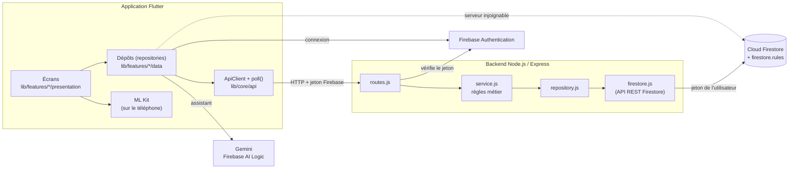

# PetCare Community : réflexion et choix du projet

Ce document décrit l'ensemble du projet PetCare : objectif, architecture, modules, données, API, choix techniques et place de l'IA. Chaque module a son propre document détaillé (section 4).

---

## 1. Le projet

PetCare Community est une application mobile pour les propriétaires d'animaux en Tunisie. Elle permet de :

- tenir la fiche de ses animaux et suivre leur poids, avec une alerte en cas de variation anormale ;
- tenir leur carnet de santé (vaccins, visites, traitements) ;
- gérer ses rendez-vous et ses rappels de soins ;
- trouver des professionnels (vétérinaires, toiletteurs, pensions…) et réserver une prestation ;
- adopter un animal ou publier une annonce d'adoption, et partager des histoires d'adoption (Happy Tails) ;
- poser ses questions à un assistant IA qui connaît ses animaux.

Le cahier des charges est dans `PetCare_Flutter_Version_Equipe.docx`, les maquettes Stitch dans `maquettes/` et
`designs/`.

### Modules et branches

| Module | Contenu | Branches d'origine |
|---|---|---|
| Utilisateurs | Inscription, connexion, rôles, profil, notifications, Accueil | `Users` |
| 1. Profils des animaux | Fiches, photos, poids, alerte de poids, archivage | `animals`, `alerte` |
| 2. Santé | Carnet de santé, traitements, tableau du jour, PDF, scan, fiches santé | `health_record`, `health-features` |
| 3. Rendez-vous et rappels | Agenda, rendez-vous, rappels de soins | `rendez-vous`, `rendez-vous-api` |
| 4. Perdus & trouvés | Prévu (voir Perspectives) | – |
| 5. Adoption | Annonces, candidatures, score de compatibilité, Happy Tails | `Adoption`, `adoption-api` |
| 6. Services | Annuaire, prestations, disponibilités, validation, réservations | `services` |
| Assistant IA | Assistant Gemini, actions à confirmer, rédaction d'annonce | `chatbot` |

Toutes ces branches sont fusionnées dans `main`.

---

## 2. Technologies

| Domaine | Choix |
|---|---|
| Application | Flutter (Dart 3.13), cible principale Android |
| Authentification | Firebase Authentication (e-mail et mot de passe) |
| Base de données | Cloud Firestore, projet `petcare-communit`, plan gratuit Spark |
| Backend | Node.js 18+ et Express (`backend/`), sans autre dépendance |
| Sécurité des données | `firestore.rules` |
| IA générative | Gemini par Firebase AI Logic (`firebase_ai`) |
| Reconnaissance de texte | Google ML Kit sur le téléphone (`google_mlkit_text_recognition`) |
| PDF | `pdf` et `printing` |
| Langues | Français et anglais (`flutter_localizations`, fichiers `.arb`) |
| Autres paquets | `http`, `image_picker`, `file_picker`, `shared_preferences`, `url_launcher`, `google_fonts`, `material_symbols_icons` |

---

## 3. Architecture



### Principes communs à tous les modules

1. **Organisation par fonctionnalité.** Chaque module a son dossier `lib/features/<module>/` avec `data/`
   (modèles, dépôt) et `presentation/` (écrans, widgets). `lib/core/` contient ce qui est partagé.
2. **API REST d'abord, Firestore en secours.** Les dépôts appellent le backend avec `ApiClient`. Si le serveur
   ne répond pas, ils font la même opération directement dans Firestore : l'application reste utilisable sans
   backend.
3. **Backend en trois couches.** Dans chaque module du serveur, `routes.js` (HTTP) appelle `service.js` (règles
   métier), qui appelle `repository.js` (accès aux données). Le service reçoit son dépôt en paramètre : on le teste
   avec un faux dépôt en mémoire, sans Firebase.
4. **Un backend sans clé secrète.** Le serveur vérifie le jeton Firebase de l'utilisateur, puis appelle l'API REST de
   Firestore avec ce même jeton. Les règles de `firestore.rules` s'appliquent donc toujours, par l'API comme en accès
   direct.
5. **Mise à jour des écrans par interrogation.** L'API ne pousse pas les changements : `poll()` relit les données à
   intervalle régulier et tout de suite après une modification (`notifyApiDataChanged()`). La lecture s'arrête quand
   l'application passe en arrière-plan, et les requêtes identiques envoyées en même temps sont regroupées.
6. **Pas de Cloud Storage.** Le plan Spark ne le permet pas : photos et pièces jointes sont stockées dans Firestore
   (base64 ou octets), sous la limite de 1 Mo par document.

### Organisation du code

```
lib/
  main.dart, firebase_options.dart
  core/          api/ (ApiClient, poll), locale/, navigation/ (onglets), routes.dart, theme/, utils/, widgets/
  features/
    auth/, profile/, notifications/, home/     module Utilisateurs et Accueil
    pets/          module Profils des animaux
    health/        module Santé
    appointments/  module Rendez-vous et rappels
    community/     onglet Communauté (Adoption, Happy Tails, Perdus & trouvés)
    adoption/      module Adoption
    services/      module Services
    assistant/     assistant IA
  l10n/          textes français et anglais

backend/
  src/server.js, app.js     démarrage et assemblage des modules
  src/auth.js               vérification du jeton Firebase
  src/firestore.js          accès à Firestore par son API REST
  src/notifier.js           notifications envoyées par le serveur
  src/users/, pets/, health/, appointments/, adoption/, services/   routes → service → dépôt
  scripts/                  données de démonstration
  test/                     tests (node --test)

test/            tests Flutter
docs/            documentation
firestore.rules  règles de sécurité Firestore
```

### Navigation

Barre du bas à 5 onglets : **Accueil**, **Mes animaux**, **Santé**, **Communauté**, **Services**. L'en-tête contient
le choix de la langue, la cloche des notifications et l'accès au profil. Les autres écrans s'ouvrent par les routes
nommées de `AppRoutes`.

---

## 4. Documentation par module

| Module | Document | En bref |
|---|---|---|
| Utilisateurs et Accueil | [MODULE_UTILISATEURS.md](MODULE_UTILISATEURS.md) | Rôles (propriétaire, prestataire, refuge, admin), profil, notifications, Accueil, visiteur |
| 1. Profils des animaux | [MODULE_ANIMAUX.md](MODULE_ANIMAUX.md) | Fiches, galerie, pesées et courbe, **alerte de poids** (règles sourcées), archivage, espèce libre |
| 2. Santé | [MODULE_SANTE.md](MODULE_SANTE.md) | Onglet Santé, tableau du jour, carnet, vaccins, traitements, PDF, scan d'ordonnance, fiches santé |
| 3. Rendez-vous et rappels | [MODULE_RENDEZ_VOUS.md](MODULE_RENDEZ_VOUS.md) | Agenda, statuts et règles RG-12 à RG-21, report avec historique, versions, rappels |
| 4. Perdus & trouvés | – | Pas encore développé |
| 5. Adoption | [MODULE_ADOPTION.md](MODULE_ADOPTION.md) | Fil filtré, annonces, candidature en 4 étapes, **score de compatibilité**, réservation, adoption, Happy Tails |
| 6. Services | [MODULE_SERVICES.md](MODULE_SERVICES.md) | Annuaire, espace prestataire, validation par l'administrateur, réservations |
| Assistant IA | [MODULE_ASSISTANT_IA.md](MODULE_ASSISTANT_IA.md) | Gemini, contexte de l'animal, actions à confirmer, garde-fous santé |
| Démonstration | [DONNEES_DEMO.md](DONNEES_DEMO.md) | Comptes, données et scénario de démonstration |

Les modules sont reliés entre eux :
- la collection `pets` (Profils des animaux) sert à la santé, aux rendez-vous, aux services et à l'assistant ;
- un vaccin (Santé) peut créer un rappel ou un rendez-vous (Rendez-vous et rappels) ;
- l'adoption, les services et l'alerte de poids envoient des notifications (module Utilisateurs) ;
- le bouton « Conseils » de la fiche d'un animal ouvre l'assistant avec cet animal déjà sélectionné ;
- l'assistant prépare des soins, traitements, pesées, rendez-vous, rappels et réservations avec les dépôts des
  modules concernés.

---

## 5. Données (Cloud Firestore)

| Collection | Module | Contenu |
|---|---|---|
| `users/{uid}`, `.../notifications` | Utilisateurs | Profil et rôle, notifications |
| `users/{uid}/adoptionFavorites`, `likedHappyTails`, `healthBookmarks` | Adoption, Santé | Favoris, « j'aime », marque-pages |
| `users/{uid}/assistantUsage`, `assistantChats/.../messages` | Assistant | Compteur du jour, historique des conversations |
| `pets/{petId}`, `.../photos`, `.../weights` | Profils des animaux | Fiche, photos (octets), pesées (une par jour) |
| `pets/{petId}/healthEntries`, `.../files`, `treatments` | Santé | Carnet de santé, pièces jointes, traitements |
| `healthSheets` | Santé | Fiches santé publiques |
| `appointments`, `reminders` | Rendez-vous et rappels | Rendez-vous et rappels |
| `adoptions`, `.../photos`, `adoptionApplications`, `happyTails`, `reports` | Adoption | Annonces, candidatures, histoires, signalements |
| `serviceCategories`, `serviceProviders`, `.../services`, `.../availability`, `serviceBookings` | Services | Annuaire, prestations, horaires, réservations |

Règles (`firestore.rules`) : tout ce qui n'est pas déclaré est fermé. Les données privées (animaux, carnet,
rendez-vous, rappels, historique de l'assistant) ne sont lisibles que par leur propriétaire. Les champs autorisés sont
listés un par un, et les valeurs et les transitions de statut sont vérifiées. Après un changement :
`firebase deploy --only firestore:rules`.

---

## 6. API REST (backend)

Toutes les routes, sauf `/api/health` et les lectures publiques (fil d'adoption, annuaire), exigent
`Authorization: Bearer <jeton Firebase>`. La liste complète est dans [backend/README.md](../backend/README.md).

| Préfixe | Module | Routes principales |
|---|---|---|
| `/api/health` | – | Le serveur répond |
| `/api/users/me` | Utilisateurs | Profil, notifications |
| `/api/pets` | Profils des animaux | Fiches, archivage, galerie, pesées (avec l'alerte de poids) |
| `/api/health/summary`, `/api/pets/{id}/health/...` | Santé | Synthèse, carnet, pièces jointes, traitements, prises |
| `/api/appointments`, `/api/reminders` | Rendez-vous et rappels | Agenda, confirmation, report, annulation, fin, rappels |
| `/api/adoptions`, `/api/applications` | Adoption | Fil filtré, annonces, favoris, candidatures (score calculé par le serveur) |
| `/api/services/...` | Services | Catégories, prestataires, validation, prestations, horaires, réservations |

Erreurs : JSON `{"error": "message en français"}`, avec `400`, `401`, `403`, `404` ou `409`.

---

## 7. Choix techniques et décisions

| Décision | Pourquoi |
|---|---|
| **Flutter**, Android en priorité | Une seule base de code pour Android et iOS ; l'application est pensée pour le téléphone |
| **Firebase Authentication** | Comptes, connexion et mot de passe oublié sûrs, sans les coder soi-même |
| **Cloud Firestore** | Base NoSQL prête à l'emploi, sans serveur à héberger ; les documents et sous-collections suivent la structure des écrans (un animal et son carnet) |
| **Plan gratuit Spark** | Projet étudiant sans budget. Conséquences : pas de Cloud Storage, pas de Cloud Functions, quota de lectures limité |
| **API REST Node.js / Express** en plus de Firestore | Logique métier centralisée (validation, score de compatibilité, transitions de rendez-vous, alerte de poids), et une API exigée par le projet |
| **Architecture routes / service / dépôt** | Chaque couche a un seul rôle ; les règles métier se testent sans Firebase |
| **Serveur sans clé secrète** (jeton de l'utilisateur) | Rien de sensible sur le serveur ; les règles Firestore restent la protection finale, même si l'API a un défaut |
| **Repli automatique sur Firestore** | L'application fonctionne même quand le backend n'est pas lancé |
| **Interrogation (`poll`)** plutôt que temps réel | Simple et compatible avec l'API REST ; arrêt en arrière-plan et requêtes regroupées pour économiser le quota |
| **Mêmes calculs côté serveur et côté application**, avec des cas de test communs | Score de compatibilité, règles des rendez-vous et alerte de poids identiques avec ou sans serveur |
| **Photos et pièces jointes dans Firestore** | Spark n'inclut pas Cloud Storage ; images compressées sous 1 Mo |
| **Archivage plutôt que suppression** | Animaux, annonces, rendez-vous et réservations gardent leur historique |
| **Rôle administrateur attribué à la main** | Personne ne peut se déclarer administrateur à l'inscription |
| **Gemini par Firebase AI Logic** | IA gratuite sur Spark, sans clé d'API à cacher dans l'application |
| **ML Kit sur le téléphone** pour le scan | Hors ligne, gratuit, sans quota ; l'ordonnance ne quitte pas le téléphone |
| **Alerte de poids par règles**, sans IA générative | Résultat fiable, explicable et sourcé (VCA, WSAVA, AAHA), sans coût ni clé |
| **Une branche par module**, fusion dans `main` par pull request | Chacun avance sans bloquer les autres ; `main` reste la version de référence |
| **Français et anglais** | Bouton de langue dans l'en-tête ; le français est la langue de référence |

### 7.1 Pourquoi Firebase

| Besoin du projet | Ce que Firebase apporte | Alternative écartée |
|---|---|---|
| Comptes sécurisés (inscription, connexion, mot de passe oublié) | **Authentication** gère les mots de passe, les e-mails de réinitialisation et les jetons signés | Coder soi-même le stockage des mots de passe et les jetons JWT : plus long et risqué |
| Base de données sans serveur à installer ni à maintenir | **Cloud Firestore**, hébergée par Google, disponible tout de suite pour toute l'équipe | MySQL ou PostgreSQL : il faut un serveur hébergé, des sauvegardes, des migrations de schéma |
| Données qui suivent les écrans | Documents et **sous-collections** : un animal avec ses photos, ses pesées, son carnet et ses traitements | Modèle relationnel : nombreuses jointures pour afficher une seule fiche |
| Sécurité des données privées | **Règles de sécurité** vérifiées par Google à chaque lecture et écriture, même si l'API a un défaut | Contrôles uniquement dans le code du serveur |
| Application utilisable sans backend | SDK Flutter officiel (`cloud_firestore`) : accès direct en repli quand le serveur est éteint | Base accessible seulement par l'API |
| IA dans l'application | **Firebase AI Logic** donne accès à Gemini sans clé d'API dans l'application | Appeler une API d'IA depuis un serveur qui garde une clé secrète |
| Budget nul | **Plan Spark gratuit** : Authentication, Firestore et AI Logic inclus | Services payants dès le départ |
| Travail en équipe | Un seul projet `petcare-communit` partagé, console web pour voir et corriger les données | Une base locale par développeur, à synchroniser |

Firebase a aussi ses contraintes : pas de Cloud Storage sur Spark, un quota de lectures limité, et un fonctionnement
NoSQL où les requêtes doivent être prévues à l'avance. Nous en avons tenu compte : les photos sont stockées dans
Firestore, les lectures sont regroupées et suspendues en arrière-plan, et les identifiants sont choisis pour éviter
des requêtes (`{annonce}_{uid}`, pesée identifiée par sa date).

### 7.2 Pourquoi une architecture feature-first

Le code Flutter est organisé **par fonctionnalité** (`lib/features/pets/`, `health/`, `adoption/`…), et non par type
de fichier (un dossier `screens/`, un dossier `models/`, un dossier `services/` pour toute l'application). Chaque
fonctionnalité contient ses propres couches :

```
lib/features/<module>/
  data/           modèles et dépôt (repository) : seul endroit qui parle à l'API et à Firestore
  presentation/   écrans et widgets : n'utilisent que le dépôt, jamais l'API ni Firestore directement
lib/core/         ce qui est partagé : ApiClient, poll(), thème, routes, langue
```

| Raison | Concrètement dans PetCare |
|---|---|
| **Un module = un dossier = un membre de l'équipe** | Chacun travaille sur sa branche et dans son dossier : très peu de conflits lors des fusions dans `main` |
| **Tout ce qui concerne une fonctionnalité est au même endroit** | Pour comprendre ou modifier l'adoption, on ouvre `lib/features/adoption/` et `backend/src/adoption/`, rien d'autre |
| **Séparation des couches à l'intérieur de chaque module** | Les écrans ne connaissent ni l'API ni Firestore : le passage API REST d'abord, Firestore en secours, s'est fait dans les dépôts sans réécrire les écrans |
| **Dépendances claires entre modules** | Un module en utilise un autre par son dépôt public (`PetRepository().watchMine`, `NotificationService().send`) ; le partagé est dans `lib/core/` |
| **Ajouter un module sans toucher aux autres** | L'assistant IA a été ajouté dans `lib/features/assistant/` avec ses écrans et ses dépôts, en réutilisant ceux des autres modules |
| **Même découpage côté serveur** | `backend/src/<module>/` avec `routes.js → service.js → repository.js` : la même carte mentale de l'application au serveur |
| **Testable** | La logique de chaque module (score, règles des rendez-vous, alerte de poids) est dans des fonctions pures, testées sans interface ni Firebase |

Une organisation par type de fichier aurait mélangé les six modules dans les mêmes dossiers. Chaque fusion aurait
touché les mêmes répertoires, et retrouver le code d'une fonctionnalité aurait demandé de parcourir tout le projet.

### 7.3 Choix propres à Flutter

**Gestion d'état : les outils natifs de Flutter.** Nous n'avons pas ajouté de bibliothèque de gestion d'état
(Provider, Bloc, Riverpod) : les outils intégrés à Flutter suffisent pour la façon dont l'application est construite.

| Type d'état | Outil | Exemple |
|---|---|---|
| Données partagées (animaux, rendez-vous, annonces, notifications) | Les dépôts exposent des `Stream`, affichés avec `StreamBuilder` | `PetRepository().watchMine(uid)` alimente Mes animaux, l'Accueil et l'assistant |
| Lecture unique | `Future` et `FutureBuilder` | Photos d'une annonce d'adoption, favoris |
| État local d'un écran (formulaire, filtre, onglet, sélection) | `StatefulWidget` et `setState` | Filtres du fil d'adoption, étapes de la candidature |
| État global simple | `ValueNotifier` | Langue choisie (`LocaleController`), alertes de poids ignorées |

Pourquoi ce choix :
- **la source de vérité est la base de données**, pas la mémoire du téléphone : chaque écran s'abonne au flux de son
  dépôt, qui relit l'API (`poll()`) ou Firestore, et se met à jour tout seul après une modification
  (`notifyApiDataChanged()`) ;
- les dépôts jouent déjà le rôle de couche de données entre les écrans et le serveur : une couche de plus n'apportait
  rien à la taille du projet ;
- ce sont les notions de base du cours, que les cinq membres de l'équipe maîtrisent : le code de chaque module reste
  lisible par tous.

Si l'application grandissait, l'étape suivante serait Riverpod ou Provider, pour injecter une seule instance de chaque
dépôt et remplacer facilement un dépôt par un faux dans les tests de widgets. Le passage serait simple : les écrans
dépendent déjà d'un dépôt, et non de l'API ou de Firestore.

**Autres choix**

| Sujet | Choix | Pourquoi |
|---|---|---|
| Asynchrone et erreurs | `async` / `await`, `try` / `catch` autour de chaque appel réseau, vérification de `mounted` après chaque `await`, message clair en français dans un `SnackBar` | Une erreur réseau ne fait jamais planter l'écran, et on n'appelle jamais `setState` sur un écran que l'utilisateur a quitté |
| Navigation | Routes nommées centralisées dans `AppRoutes`, arguments passés par `settings.arguments` ; un écran peut renvoyer un résultat avec `Navigator.pop` (par exemple l'onglet à afficher) | Toutes les routes sont au même endroit, et un module ouvre l'écran d'un autre sans l'importer (`pushNamed(AppRoutes.healthRecord, arguments: pet.id)`) |
| Code propre au mobile | Import conditionnel : `text_scanner.dart` choisit `text_scanner_mlkit.dart` quand `dart:io` existe, sinon une version vide ; `kIsWeb` et `Platform` masquent le bouton de scan | La même base de code compile pour Android, iOS et le web, sans plantage sur une plateforme où ML Kit n'existe pas |
| Langues | `flutter_localizations`, textes dans `app_fr.arb` (modèle) et `app_en.arb`, classe `AppLocalizations` générée par `flutter gen-l10n` ; langue choisie gardée par `shared_preferences` | Les textes traduits sont tous au même endroit, une langue de plus se réduit à un fichier `.arb`, et le choix de l'utilisateur est mémorisé |

---

## 8. Utilisation de l'IA

L'IA intervient à deux niveaux : **dans l'application**, pour l'utilisateur, et **dans le développement**, pour
l'équipe.

### 8.1 Dans l'application

| Fonctionnalité | Technologie | Rôle de l'IA | Garde-fous |
|---|---|---|---|
| Assistant PetCare | Gemini (`gemini-3.5-flash-lite`) par Firebase AI Logic | Conseils sur les soins, la santé, l'alimentation, le comportement et l'adoption, adaptés à l'animal choisi et à son carnet | Jamais de diagnostic ni de dose de médicament ; urgences signalées en premier ; sujets limités aux animaux ; 30 messages par jour |
| Actions de l'assistant | Appels de fonction Gemini | Préparer un soin, un traitement, une pesée, un rendez-vous, un rappel ou une réservation | Carte à vérifier, rien n'est enregistré sans « Confirmer » ; mêmes règles que les formulaires ; aucune valeur inventée |
| Suggestions d'adoption | Gemini, avec la liste réelle des annonces | Proposer jusqu'à 3 animaux adaptés au foyer décrit | Seuls les animaux réellement publiés, cités par leur identifiant ; la décision revient au refuge |
| « Rédiger avec l'IA » | Gemini | Écrire la description d'une annonce d'adoption | Uniquement à partir des champs remplis ; texte modifiable avant publication |
| Scan d'ordonnance ou de vignette | Google ML Kit (reconnaissance de texte, sur le téléphone) | Lire le texte de la photo pour pré-remplir le formulaire | Jamais de posologie ; l'utilisateur vérifie tout avant d'enregistrer |

Ce qui n'est **pas** de l'IA, par choix :
- **l'alerte de poids** : des règles fixes et sourcées (perte de plus de 10 % en 90 jours selon VCA, etc.), le même
  résultat à chaque fois, qui s'explique au propriétaire ;
- **le score de compatibilité** de l'adoption : un barème transparent, que l'annonceur peut comprendre et contester.

Pour une décision qui touche la santé de l'animal ou le choix d'un adoptant, une règle explicable vaut mieux qu'une
réponse générée qui peut varier.

### 8.2 Dans la conception et le développement

| Outil | Utilisation |
|---|---|
| **Google Stitch** (génération d'interfaces par IA) | Maquettes des écrans et illustrations, à partir de descriptions écrites (`maquettes/`, `designs/`). Elles ont servi de modèle aux écrans Flutter |
| **Claude Code** (assistant de programmation d'Anthropic, dans VS Code) | Partenaire de conception et de développement tout au long du projet, selon la démarche décrite ci-dessous |

Démarche de travail avec Claude Code :

1. **Contexte d'abord** : explication de l'idée du projet, de son contexte et du cahier des charges, pour que
   l'assistant comprenne le but de chaque module.
2. **Un prompt par module** : rédaction de prompts précis pour chaque module, afin de couvrir le maximum de
   fonctionnalités de base du cahier des charges.
3. **Brainstorming** : échange avec l'assistant pour améliorer les idées, en ajouter
   et formaliser chaque idée dans un prompt clair avant de la lancer.
4. **Réalisation puis amélioration** : lancement du prompt, correction des erreurs, puis améliorations successives.
5. **Tests** : préparation et exécution des tests, avec des cas de test communs au serveur et à l'application
   (`npm test`, `flutter test`, `flutter analyze`) et essai sur l'émulateur.
6. **Fusion sans risque** : travail sur une branche, jamais directement sur `main`, et vérification des conflits
   avant chaque fusion par pull request.
7. **Recherche de sources externes** : informations de référence vérifiées, comme les seuils de poids issus
   d'organismes vétérinaires (WSAVA, VCA, AAHA, iCatCare). Les repères non officiels sont signalés comme tels dans
   l'application.
8. **Documentation** : rédaction de la documentation du projet et des modules, et préparation des données de
   démonstration.

**Le principe le plus important : Claude ne modifie rien sans la confirmation et la validation de l'utilisateur.**
L'assistant propose, l'étudiant relit, valide ou corrige, et c'est seulement ensuite que le code change. Aucun
secret (clé d'API, mot de passe) n'est jamais écrit dans le dépôt.

---

## 9. Tests

| Commande | Contenu |
|---|---|
| `cd backend; npm test` | Validation des champs, services avec un faux dépôt (utilisateurs, adoption, santé, services), score de compatibilité, filtres d'adoption, règles des rendez-vous, routes des animaux et de la santé avec un faux Firestore, alerte de poids |
| `flutter test` | Formulaires de connexion, dates relatives, interrogation et regroupement des requêtes, règles des rendez-vous et de la santé, synthèse et PDF du carnet, scan, score de compatibilité, lecture JSON de l'API, alerte de poids, assistant (actions, cartes, prestations) |
| `flutter analyze` | Analyse statique du code Dart |

---

## 10. Lancer le projet

1. Backend : `cd backend`, `npm install`, `npm start` (http://localhost:3000, vérification : `/api/health`).
2. Émulateur Android depuis Android Studio, ou `flutter emulators --launch <nom>`.
3. Application : `flutter pub get`, puis `flutter run`.

Sous Windows, activer le **Mode développeur** avant `flutter pub get`. L'émulateur joint le PC par `10.0.2.2:3000` ;
pour un téléphone réel : `flutter run --dart-define=API_URL=http://<IP du PC>:3000`. Le trafic `http` n'est autorisé
qu'en mode debug. **Arrêter le serveur et l'application après les tests** (quota gratuit partagé).

Données de démonstration : [DONNEES_DEMO.md](DONNEES_DEMO.md) (`node scripts/seed-demo-complet.js`). Les scripts
plus anciens `seed-services.js` (annuaire) et `seed-demo-user.js` (un compte de test) restent disponibles.

---

## 11. Perspectives

- **Module Perdus & trouvés** : signaler un animal perdu ou trouvé, avec une carte.
- **Notifications push** (Firebase Cloud Messaging) pour les rappels et les alertes.
- **Hébergement du backend** en `https` pour une mise en production.
