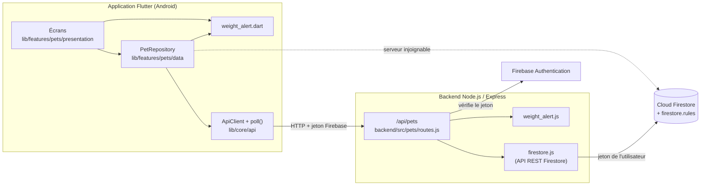

# Module 1 : Profils des animaux

Ce document décrit le module « Mes animaux » de PetCare : ce qu'il fait, comment il est construit, et pourquoi il
est construit ainsi. Il est à jour à la branche `alerte` (commit `351d0d7`, novembre 2026).

Branches du module :

| Branche | Contenu | État |
|---|---|---|
| `animals` | Écrans, API REST `/api/pets`, correction des pesées, bouton Conseils, espèce libre | Fusionnée dans `main` |
| `alerte` | Alerte intelligente de poids | Poussée, fusion vers `main` à valider |

---

## 1. Vue d'ensemble

Le module permet à un propriétaire de tenir la fiche de chacun de ses animaux : identité, photos, poids, notes et
contacts de confiance. C'est aussi le point d'entrée vers les autres modules (carnet de santé, rendez-vous, rappels,
services), qui s'appuient sur la collection `pets`.

Fonctionnalités :

- liste « Mes animaux » (actifs et archivés, recherche, tri) et état vide ;
- fiche d'un animal ;
- ajout et modification d'une fiche ;
- galerie de 5 photos, avec choix de la photo principale ;
- suivi du poids : pesées, courbe, historique, correction ;
- alerte intelligente de poids, avec notification immédiate ;
- notes privées et contacts (vétérinaire traitant, urgence) ;
- favori et partage limité de la fiche ;
- archivage et restauration (jamais de suppression) ;
- espèce « Autre » avec saisie libre (ours, tigre, tortue…) ;
- bouton « Conseils » (réservé au futur assistant IA) ;
- application en français et en anglais.

---

## 2. Architecture



### Principes

1. **L'application passe par l'API REST.** Chaque lecture et écriture appelle d'abord `/api/pets`.
2. **Repli sur Firestore.** Si le serveur ne répond pas (éteint, mauvaise adresse, pas de réseau), `PetRepository`
   fait la même opération directement dans Firestore. L'application reste utilisable sans backend.
3. **Le serveur ne détient aucune clé secrète.** Il appelle Firestore avec le jeton de l'utilisateur : les règles de
   `firestore.rules` s'appliquent à chaque requête, que l'on passe par l'API ou non.
4. **Les écrans ne connaissent ni l'API ni Firestore.** Ils utilisent seulement `PetRepository` et reçoivent des flux
   (`Stream`) qu'ils affichent avec des `StreamBuilder`.

### Fichiers

```
lib/features/pets/
  data/
    pet.dart                      modèle Pet, PetDraft, PetContact, énumérations (espèce, sexe, statut)
    pet_media.dart                PetPhoto, WeightEntry (lecture Firestore et JSON)
    pet_repository.dart           API REST + repli Firestore, notification d'alerte hors ligne
    weight_alert.dart             analyse des pesées (règles de l'alerte de poids)
    weight_alert_dismissals.dart  alertes « ignorées », mémorisées sur l'appareil
  presentation/
    my_pets_screen.dart           onglet Mes animaux
    pet_detail_screen.dart        fiche d'un animal
    pet_form_screen.dart          ajout et modification
    pet_format.dart, pet_style.dart  formats (âge, poids, dates) et couleurs des maquettes
    widgets/                      archivage, photo, courbe de poids, bandeau d'alerte

backend/src/pets/
  routes.js        routes /api/pets
  validation.js    contrôle des champs reçus
  enums.js         valeurs fixes (espèces, sexes, statuts)
  weight_alert.js  analyse des pesées (même logique que weight_alert.dart)

backend/test/pets.test.js, weight_alert.test.js, fixtures/weight_alert_cases.json
test/pets_api_json_test.dart, test/weight_alert_test.dart
designs/animals/   maquettes Stitch du module
```

---

## 3. Données (Cloud Firestore)

| Chemin | Contenu |
|---|---|
| `pets/{petId}` | `ownerId`, `name`, `species` (`dog`, `cat`, `rabbit`, `rodent`, `bird`, `other`), `sex` (`male`, `female`), `breed`, `birthDate`, `birthDateEstimated`, `chipNumber`, `sterilized`, `notes`, `status` (`active`, `archived`), `archivedReason`, `favorite`, `contacts` (5 au maximum), `createdAt`, `updatedAt` |
| `pets/{petId}/photos/{id}` | `data` (image en octets), `sortOrder` (0 = photo principale), `createdAt` |
| `pets/{petId}/weights/{AAAA-MM-JJ}` | `measuredOn`, `weightKg`, `note`, `createdAt` (une pesée par jour) |
| `users/{uid}/notifications/poids-…` | notification d'alerte de poids (catégorie `sante`) |

Choix de modélisation :

- **Photos dans Firestore, en octets.** Le projet est sur le plan gratuit Spark, sans Cloud Storage. Chaque photo
  est un document séparé pour rester sous la limite de 1 Mo par document (750 Ko par photo, contrôlé par les règles).
- **Une pesée par jour.** L'identifiant du document est la date (`2026-11-04`) : deux pesées le même jour sont
  impossibles, sans requête supplémentaire.
- **Le poids n'est pas dans la fiche.** Il vit dans `weights`, ce qui évite toute donnée en double.
- **Espèce libre.** Avec `species: other`, le champ `breed` contient l'animal saisi (« Ours »). Aucun nouveau champ,
  donc aucune modification des règles Firestore.
- **Pas de suppression.** Un animal est archivé : son historique est conservé (règles RG-06 et RG-07).

Règles de sécurité (`firestore.rules`, bloc `pets`) :

- seul le propriétaire lit et modifie sa fiche, ses photos et ses pesées ;
- champs autorisés listés un par un (`keys().hasOnly`) ; nom de 2 à 80 caractères, notes de 500 au plus ;
- puce : 15 chiffres ; date de naissance et date de pesée jamais dans le futur ; poids entre 0 et 500 kg ;
- suppression d'une fiche interdite.

---

## 4. API REST `/api/pets`

Toutes les routes exigent `Authorization: Bearer <jeton Firebase>`.

| Méthode | Route | Rôle |
|---|---|---|
| GET | `/api/pets?status=active` | Mes animaux, récents d'abord (`status` facultatif) |
| POST | `/api/pets` | Crée la fiche, ses photos et sa première pesée en une seule écriture |
| GET | `/api/pets/{id}` | Lit une fiche |
| PUT | `/api/pets/{id}` | Modifie la fiche et remplace la galerie dans l'ordre donné |
| PATCH | `/api/pets/{id}` | Modifie seulement `notes`, `favorite` ou `contacts` |
| POST | `/api/pets/{id}/archive` | Archive |
| POST | `/api/pets/{id}/restore` | Restaure |
| GET | `/api/pets/{id}/photos` | Galerie en base64, la photo principale d'abord |
| GET | `/api/pets/{id}/cover` | Photo principale seule |
| POST | `/api/pets/{id}/photos` | Ajoute une photo (409 au-delà de 5) |
| DELETE | `/api/pets/{id}/photos/{photoId}` | Supprime une photo et recompacte l'ordre |
| POST | `/api/pets/{id}/photos/{photoId}/cover` | Choisit la photo principale |
| GET | `/api/pets/{id}/weights?limit=` | Pesées, la plus récente d'abord |
| POST | `/api/pets/{id}/weights` | Ajoute une pesée (409 si ce jour a déjà une pesée) |
| PUT | `/api/pets/{id}/weights/{entryId}` | Corrige le poids et la note |
| DELETE | `/api/pets/{id}/weights/{entryId}` | Supprime une pesée |

Erreurs : JSON `{"error": "message en français"}`, avec `400` (champ invalide), `401` (jeton manquant ou expiré),
`403` (pas votre animal), `404`, `409` (état incompatible : animal archivé, pesée en double, 6e photo).

Détails techniques :

- **Photos.** Firestore stocke des octets (`bytesValue`) ; l'API les échange en base64. Le corps des requêtes est
  limité à 6 Mo (5 photos de 750 Ko).
- **Dates de pesée.** L'application envoie le jour (`date`, identifiant) et le minuit local (`measuredOn`) : le jour
  reste juste quel que soit le fuseau horaire. Le serveur vérifie que les deux concordent.
- **Délai réseau.** Un envoi de photos a 60 secondes au lieu de 8 : sinon une écriture lente serait prise pour un
  serveur éteint, et le repli sur Firestore créerait l'animal en double.

---

## 5. Spécifications des fonctionnalités

### 5.1 Mes animaux

- Liste des animaux actifs ou archivés (onglets), recherche par nom, race ou espèce, tri par date ou par nom.
- Chaque carte : photo principale, nom, espèce et race, âge, dernier poids, badge « Alerte poids », raccourcis
  Santé et Rendez-vous.
- État vide avec bouton d'ajout ; invitation à se connecter pour un visiteur.

### 5.2 Fiche d'un animal

- Galerie, identité, âge, stérilisation, puce (tronquée hors de la fiche), notes, contacts.
- Cartes Carnet de santé, Rendez-vous et Rappels reliées aux autres modules.
- Actions : modifier, favori, partager (sans puce, ni notes, ni données médicales), archiver ou restaurer, Conseils.

### 5.3 Ajout et modification

- Champs obligatoires : nom (2 à 80 caractères), espèce, sexe, date de naissance (non future, estimée ou non).
- Espèce « Autre » : le champ devient « Quel animal ? » et devient obligatoire.
- Jusqu'à 5 photos, la première en couverture ; poids facultatif enregistré comme pesée du jour.
- Le champ Identification (puce) a été retiré du formulaire sur `main` : une fiche existante garde sa puce.

### 5.4 Suivi du poids

- Ajout d'une pesée avec date et note ; confirmation demandée si l'écart dépasse 30 % avec la pesée précédente.
- Courbe des 6 dernières pesées et tendance par rapport à la précédente.
- Historique complet : **correction** du poids et de la note (le jour ne change pas, car il identifie la pesée),
  suppression.

### 5.5 Archivage

- L'animal archivé quitte la liste des actifs ; tout son historique est conservé.
- Il reste consultable et restaurable, mais **non modifiable** : l'API renvoie 409, et l'application masque les
  boutons de modification (fiche, favori, notes, contacts, photos, pesées).

### 5.6 Alerte intelligente de poids (branche `alerte`)

**Objectif.** Prévenir tout de suite le propriétaire quand le poids varie anormalement, et l'inviter à consulter un
vétérinaire. Ce n'est jamais un diagnostic.

**Déclenchement dynamique.** L'analyse tourne à chaque pesée ajoutée ou corrigée, et à chaque fiche enregistrée avec
un poids. Il n'y a pas de contrôle périodique : une chute brutale en une semaine déclenche une notification immédiate.

**Calcul.** La dernière pesée est comparée à chacune des pesées des 90 jours précédents. Les règles sont testées de la
plus grave à la moins grave ; la première qui correspond est retenue.

| Règle | Situation | Seuil | Niveau | Base |
|---|---|---|---|---|
| `extreme` | Variation extrême | ≥ 30 % en 7 jours (« vérifiez la pesée ») | Consultez | Repère PetCare |
| `loss-10` | Perte | ≥ 10 % en 90 jours | Consultez | VCA Hospitals |
| `rapid-loss` | Perte rapide | ≥ 5 % en 7 jours (≥ 3 % pour lapin, rongeur, oiseau) | Consultez | Repère PetCare |
| `gain-20` | Forte prise (adulte) | ≥ 20 % en 90 jours | Consultez | Repère PetCare |
| `loss-5` | Perte modérée | ≥ 5 % en 30 jours | À surveiller | Repère PetCare |
| `gain-10` | Prise (adulte) | ≥ 10 % en 90 jours | À surveiller | AAHA / iCatCare |

Cas sans alerte : moins de 2 pesées, animal archivé, dernière pesée de plus de 30 jours. Une prise de poids n'est
jamais signalée avant 1 an (croissance), ni quand l'animal revient à son poids habituel (la dernière pesée doit
dépasser toutes les précédentes de la fenêtre).

**Notification.** Elle arrive dans la cloche de l'application (`users/{uid}/notifications`, catégorie Santé & Soins).
Son identifiant dépend de l'animal, de la règle et de la pesée de référence (`poids-{petId}-{règle}-{date}`) :

- un même épisode n'est notifié qu'une fois (une écriture « ne doit pas exister ») ;
- si l'alerte s'aggrave (autre règle) ou si un nouvel épisode commence, une nouvelle notification part.

**Affichage.**

- Fiche, carte Poids : bandeau rouge (« Consultez un vétérinaire ») ou orange (« Poids à surveiller ») avec la
  variation, par exemple « Milo a perdu 6 % en 7 jours (10 kg → 9,4 kg) ».
- Boutons : **Prendre rendez-vous** (formulaire de rendez-vous avec l'animal choisi), **Voir les vétérinaires**
  (Services, catégorie Vétérinaires), **Sources**, **Ignorer**.
- Si un rendez-vous vétérinaire est pris après la pesée de l'alerte, le bandeau affiche « Rendez-vous vétérinaire
  prévu le … » à la place des boutons.
- Mes animaux : badge « Alerte poids » sur la carte.

**Sources consultées (04/11/2026).**

| Source | Ce qu'elle dit |
|---|---|
| [WSAVA Nutritional Assessment Guidelines (2011)](https://pmc.ncbi.nlm.nih.gov/articles/PMC11107980/) | Une variation de poids inexpliquée justifie un examen approfondi (aucun pourcentage). |
| [VCA – chat](https://vcahospitals.com/know-your-pet/abnormal-weight-loss-in-cats), [VCA – chien](https://vcahospitals.com/know-your-pet/weight-loss-abnormal-in-dogs) | Une perte de plus de 10 % du poids habituel est cliniquement significative ; une perte rapide est plus inquiétante. |
| [AAHA 2021 Nutrition and Weight Management Guidelines](https://www.aaha.org/resources/2021-aaha-nutrition-and-weight-management-guidelines/home/) et iCatCare | 1 point de score corporel (sur 9) correspond à environ 10 % du poids. |

Aucun organisme ne publie de pourcentage pour tous les cas : les autres seuils sont des **repères PetCare (non
officiels)**, signalés comme tels dans l'application. Ils devraient être validés par un vétérinaire avant une mise en
production.

### 5.7 Autres

- **Conseils.** Le bouton ouvre « Bientôt disponible ». Il sera relié à l'assistant IA de la branche `chatbot`
  quand celle-ci sera fusionnée dans `main`.
- **Langues.** Bouton de l'en-tête ; textes dans `lib/l10n/app_fr.arb` et `app_en.arb`, choix mémorisé sur
  l'appareil (`LocaleController`).

---

## 6. Décisions prises

| Décision | Raison |
|---|---|
| API REST avec repli sur Firestore | Même logique que les autres modules ; l'application marche même serveur éteint |
| Serveur sans clé secrète (jeton de l'utilisateur) | Les règles Firestore protègent les données dans tous les cas |
| Photos en octets dans Firestore | Plan Spark gratuit, sans Cloud Storage |
| Archivage plutôt que suppression | Conserver l'historique ; animal archivé non modifiable |
| Une pesée par jour, identifiée par la date | Doublons impossibles sans requête de vérification |
| Correction d'une pesée sans changer sa date | La date est l'identifiant ; pour une mauvaise date, supprimer puis recréer |
| Espèce libre dans `breed` | Accepter tout animal sans modifier les règles Firestore |
| Alerte de poids par règles, sans IA générative | Fiable, explicable, gratuite, sans clé d'API |
| Même analyse en JavaScript et en Dart | La notification part aussi quand le serveur est éteint ; un fichier de cas commun garantit le même résultat |
| Notification dans l'application, à chaque pesée | Pas de serveur de notifications push ; alerte immédiate et non périodique |
| « Ignorer » mémorisé sur l'appareil | Aucune nouvelle collection ni règle Firestore à déployer |
| Rafraîchissement limité (photos 5 min, badge 1 min) | Le quota gratuit de Firestore a déjà été épuisé une fois |
| Travail sur des branches dédiées | `main` n'est modifiée que par fusion validée |

---

## 7. Tests

| Commande | Ce qui est vérifié |
|---|---|
| `cd backend; npm test` | Validation des champs, routes avec un faux Firestore (création, galerie, pesées, archivage, accès refusé), alerte de poids et notification sans doublon |
| `flutter test` | Lecture JSON de l'API, analyse de l'alerte sur les mêmes cas que le backend |
| `flutter analyze` | Aucun avertissement |

Les cas de l'alerte sont dans `backend/test/fixtures/weight_alert_cases.json` : perte brutale, perte lente, perte
modérée, petit animal, prise chez l'adulte, croissance d'un chiot, variation extrême, retour au poids habituel,
une seule pesée, animal archivé, pesée trop ancienne.

---

## 8. Lancer le projet

1. Backend : `cd backend`, `npm install`, `npm start` (http://localhost:3000).
2. Émulateur Android : `flutter emulators --launch Medium_Phone_API_37.0`.
3. Application : `flutter run -d emulator-5554`.

L'émulateur joint le PC à l'adresse `10.0.2.2:3000`. Pour un téléphone réel :
`flutter run --dart-define=API_URL=http://<IP du PC>:3000`. Le guide complet est dans
[LANCER_SUR_MOBILE.md](LANCER_SUR_MOBILE.md).

---

## 9. Limites connues et suites possibles

- **Blocage des animaux archivés** : appliqué par l'API et masqué dans l'interface, mais pas par `firestore.rules`.
  Serveur éteint, une écriture directe resterait possible.
- **Alerte « ignorée »** : mémorisée sur un seul appareil.
- **Notification supprimée** : elle peut revenir à la pesée suivante si l'épisode continue.
- **Seuils de poids** : repères à faire valider par un vétérinaire.
- **Quota Firestore** : le plan gratuit est partagé par toute l'équipe ; fermer l'application quand on ne teste pas.
- **Suites possibles** : relier le bouton Conseils à l'assistant IA, photo vers fiche (Gemini), plan de soins
  courants relié aux rappels, journal de bien-être.
