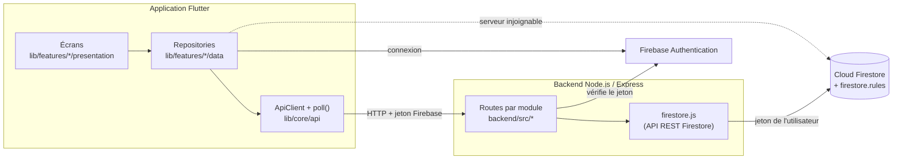

# PetCare Community : documentation du projet

Ce document décrit l'ensemble du projet PetCare tel qu'il est sur la branche `main` (commit `7c10e4c`, novembre
2026) : objectif, architecture, modules, données, API, choix techniques et décisions. Le détail du module Profils des
animaux est dans [MODULE_ANIMAUX.md](MODULE_ANIMAUX.md), et l'installation dans [LANCER_SUR_MOBILE.md](LANCER_SUR_MOBILE.md).

---

## 1. Le projet

PetCare Community est une application mobile pour les propriétaires d'animaux en Tunisie. Elle permet de :

- tenir la fiche de ses animaux, leur poids et leur carnet de santé ;
- gérer ses rendez-vous et ses rappels de soins ;
- trouver des professionnels (vétérinaires, toiletteurs, pensions…) et réserver une prestation ;
- adopter un animal ou publier une annonce d'adoption ;
- partager des histoires d'adoption (Happy Tails).

Le cahier des charges est dans `PetCare_Flutter_Version_Equipe.docx`, les maquettes Stitch dans `maquettes/` et
`designs/`.

### Équipe et modules

| Module | Contenu | Branche d'origine |
|---|---|---|
| Utilisateurs | Inscription, connexion, rôles, profil, notifications | `Users` |
| 1. Profils des animaux | Mes animaux, fiche, photos, poids, archivage | `animals` |
| 2. Santé | Carnet de santé, traitements, fiches santé | `health_record` |
| 3. Rendez-vous et rappels | Agenda, rendez-vous, rappels de soins | `rendez-vous`, `rendez-vous-api` |
| 4. Perdus & trouvés | Pas encore développé (« Bientôt disponible ») | – |
| 5. Adoption | Annonces, candidatures, score de compatibilité, Happy Tails | `Adoption`, `adoption-api` |
| 6. Services | Annuaire des professionnels, prestations, disponibilités, réservations | `services` |

Branches en cours, pas encore dans `main` : `chatbot` (assistant IA Gemini) et `alerte` (alerte intelligente de
poids, module 1).

---

## 2. Technologies

| Domaine | Choix |
|---|---|
| Application | Flutter (Dart 3.13), cible principale Android |
| Authentification | Firebase Authentication (e-mail et mot de passe) |
| Base de données | Cloud Firestore, projet `petcare-communit`, plan gratuit Spark |
| Backend | Node.js 18+ et Express (`backend/`) |
| Sécurité des données | `firestore.rules` |
| Langues | Français et anglais (`flutter_localizations`, fichiers `.arb`) |
| Paquets principaux | `firebase_core`, `firebase_auth`, `cloud_firestore`, `http`, `image_picker`, `file_picker`, `shared_preferences`, `url_launcher`, `google_fonts`, `material_symbols_icons` |

---

## 3. Architecture



### Principes communs à tous les modules

1. **Organisation par fonctionnalité.** Chaque module a son dossier `lib/features/<module>/` avec `data/`
   (modèles, repository) et `presentation/` (écrans, widgets). `lib/core/` contient ce qui est partagé.
2. **API REST d'abord, Firestore en secours.** Les repositories appellent le backend avec `ApiClient`. Si le serveur
   ne répond pas, ils font la même opération directement dans Firestore : l'application reste utilisable sans
   backend.
3. **Un backend sans clé secrète.** Le serveur vérifie le jeton Firebase de l'utilisateur, puis appelle l'API REST de
   Firestore avec ce même jeton. Les règles de `firestore.rules` s'appliquent donc toujours, par l'API comme en accès
   direct.
4. **Mise à jour des écrans par interrogation.** L'API ne pousse pas les changements : `poll()` (`lib/core/api/polling.dart`)
   relit les données à intervalle régulier (8 secondes par défaut) et tout de suite après une modification
   (`notifyApiDataChanged()`). Un même flux peut être écouté plusieurs fois.
5. **Pas de Cloud Storage.** Le plan Spark ne le permet pas : photos et pièces jointes sont stockées dans Firestore
   (base64 pour l'adoption, octets pour les animaux et la santé), une par document, sous la limite de 1 Mo.

### Organisation du code

```
lib/
  main.dart, firebase_options.dart
  core/
    api/           ApiClient (HTTP + jeton), poll() et notifyApiDataChanged()
    locale/        LocaleController (langue choisie, mémorisée sur l'appareil)
    routes.dart    AppRoutes : routes nommées de toute l'application
    theme/         couleurs et thème
    utils/, widgets/  dates relatives, bouton de langue, écran « Bientôt disponible »
  features/
    auth/          connexion, inscription, mot de passe oublié, rôles
    profile/       Mon profil, modification du profil
    notifications/ notifications dans l'application
    home/          Accueil et barre de navigation
    pets/          module 1 : Profils des animaux
    health/        module 2 : Santé
    appointments/  module 3 : Rendez-vous et rappels
    community/     onglet Communauté (Adoption, Perdus & trouvés, Happy Tails)
    adoption/      module 5 : Adoption
    services/      module 6 : Services
  l10n/            textes français et anglais

backend/
  src/server.js, app.js      démarrage et montage des routes
  src/auth.js                vérification du jeton Firebase
  src/firestore.js           accès à Firestore par son API REST
  src/validation.js          validation commune (profil)
  src/adoption/, appointments/, pets/, services/   un dossier par module
  scripts/                   données de démonstration
  test/                      tests (node --test)

test/                        tests Flutter
firestore.rules              règles de sécurité Firestore
```

### Navigation

Barre du bas à 4 onglets : **Accueil**, **Mes animaux**, **Communauté**, **Services**. L'en-tête contient le choix de
langue, la cloche des notifications et l'accès au profil. Les autres écrans s'ouvrent par les routes nommées de
`AppRoutes`.

---

## 4. Modules

### Utilisateurs

- Inscription avec choix du rôle : **propriétaire**, **prestataire** ou **refuge**. Le rôle **administrateur** n'est
  jamais proposé : il est attribué à la main dans la console Firebase.
- Connexion, mot de passe oublié, mode visiteur.
- Profil `users/{uid}` : nom, e-mail, ville, téléphone, rôle. Le rôle et l'e-mail ne changent pas après l'inscription.
- Notifications `users/{uid}/notifications` : catégories Santé & Soins, Rendez-vous, Adoptions, Communauté, Messages.
  N'importe quel utilisateur connecté peut en envoyer une ; seul le destinataire la lit et la marque comme lue.

### Accueil

Salutation, raccourci vers ses animaux, prochains rendez-vous, vaccins et traitements à venir, rappels de soins,
raccourcis Adoption et Perdus & trouvés.

### 1. Profils des animaux

Liste des animaux actifs et archivés, fiche, formulaire d'ajout et de modification, galerie de 5 photos, pesées avec
courbe et correction, notes, contacts de confiance, favori, partage, archivage et restauration, espèce libre (« Autre »),
bouton Conseils réservé à l'assistant IA. La collection `pets` sert aussi aux modules Santé et Rendez-vous.
Détails : [MODULE_ANIMAUX.md](MODULE_ANIMAUX.md).

### 2. Santé

- Carnet de santé de chaque animal : visites, vaccins, examens, allergies, notes, avec jusqu'à 3 pièces jointes
  (PDF ou photo, 900 Ko au plus).
- Prochain rappel vaccinal ; un vaccin peut créer un rappel du module 3 ou ouvrir le formulaire de rendez-vous.
- Traitements : en cours, terminés ou arrêtés, prises notées.
- Fiches Santé & Conseils publiques (écrites par l'administrateur, 5 fiches de départ intégrées), avec marque-pages.
- Le carnet est une sous-collection de la fiche : il n'est pas transmis lors d'une adoption.
- Accès direct à Firestore (pas encore d'API REST pour ce module).

### 3. Rendez-vous et rappels

- Agenda (semaine et mois, filtres par animal et statut), détail, nouveau rendez-vous, report.
- Statuts : en attente, confirmé, terminé, annulé. Un rendez-vous personnel démarre confirmé, une réservation auprès
  d'un professionnel démarre en attente et c'est le prestataire qui la confirme.
- Règles : report et annulation seulement avant le début, « Terminé » seulement après la fin, pas deux rendez-vous
  actifs qui se chevauchent pour un même animal, version obsolète refusée (deux personnes qui modifient en même temps).
- Rappels de soins créés à la main.

### 5. Adoption (onglet Communauté)

- Fil d'adoption avec recherche et filtres (espèce, âge, sexe, taille, ville, badges, « Adopte-moi »), favoris.
- Annonce : photos, badges de personnalité, compatibilités, besoins, conditions ; brouillon, publication, archivage.
- Candidature en 4 étapes (logement, foyer, mode de vie, récapitulatif), avec un **score de compatibilité** calculé à
  l'identique par le serveur et par l'application.
- Suivi : Envoyée → En étude → Acceptée → Adoptée. Une seule candidature acceptée à la fois ; l'annonce passe Réservée
  puis Adoptée, et les autres candidats sont refusés et notifiés.
- Happy Tails : histoire Avant / Après de l'adoptant, avec des « j'aime » ; signalements pour l'administrateur.
- Seuls les propriétaires et les refuges publient des annonces.

### 6. Services (onglet Services)

- Annuaire des professionnels publiés, avec recherche, filtre par catégorie et par ville.
- Catégories gérées par l'administrateur (Vétérinaires, Toiletteurs, Promeneurs, Pensions, Boutiques…).
- Un prestataire crée son profil, qui est **validé ou refusé par l'administrateur** avant d'apparaître.
- Prestations (durée de 5 minutes à 24 heures, prix), disponibilités par jour de la semaine.
- Réservations : demande du client, puis confirmation ou refus du prestataire ; le client peut annuler une demande en
  attente.

### 4. Perdus & trouvés

Pas encore développé : la carte de l'onglet Communauté et le raccourci de l'Accueil affichent « Bientôt disponible ».

---

## 5. Données (Cloud Firestore)

| Collection | Module | Contenu |
|---|---|---|
| `users/{uid}` | Utilisateurs | Profil et rôle |
| `users/{uid}/notifications` | Utilisateurs | Notifications |
| `users/{uid}/adoptionFavorites`, `likedHappyTails`, `healthBookmarks` | Adoption, Santé | Favoris, « j'aime », marque-pages |
| `pets/{petId}` | 1 | Fiche de l'animal |
| `pets/{petId}/photos`, `weights` | 1 | Photos (octets) et pesées (une par jour) |
| `pets/{petId}/healthEntries`, `.../files`, `treatments` | 2 | Carnet de santé, pièces jointes, traitements |
| `healthSheets` | 2 | Fiches santé publiques |
| `appointments`, `reminders` | 3 | Rendez-vous et rappels |
| `adoptions`, `adoptions/{id}/photos` | 5 | Annonces et photos (base64) |
| `adoptionApplications` | 5 | Candidatures (`{annonce}_{uid}` : une par personne et par annonce) |
| `happyTails`, `reports` | 5 | Histoires d'adoption, signalements |
| `serviceCategories`, `serviceProviders`, `.../services`, `.../availability`, `serviceBookings` | 6 | Annuaire, prestations, disponibilités, réservations |

Règles (`firestore.rules`) : chaque module déclare les règles de ses collections. Par défaut, tout ce qui n'est pas
déclaré est fermé. Les données privées (animaux, carnet de santé, rendez-vous, rappels) ne sont lisibles que par leur
propriétaire ; les champs autorisés sont listés un par un et les valeurs vérifiées (longueurs, statuts, dates). Après
un changement : `firebase deploy --only firestore:rules`.

---

## 6. API REST (backend)

Toutes les routes, sauf `/api/health` et la lecture publique des annonces d'adoption, exigent
`Authorization: Bearer <jeton Firebase>`. La liste complète est dans [backend/README.md](../backend/README.md).

| Préfixe | Module | Routes principales |
|---|---|---|
| `/api/health` | – | Le serveur répond |
| `/api/users/me` | Utilisateurs | Créer, lire, modifier son profil ; notifications (liste, non lues, marquer comme lue) |
| `/api/adoptions`, `/api/applications` | Adoption | Fil filtré, annonces, photos, favoris, candidatures (score calculé par le serveur) |
| `/api/appointments`, `/api/reminders` | Rendez-vous | Agenda, création, confirmation, report, annulation, fin, rappels |
| `/api/pets` | Profils des animaux | Fiches, archivage, galerie, pesées |
| `/api/services/...` | Services | Catégories, prestataires, validation, prestations, disponibilités, réservations |

Erreurs : JSON `{"error": "message en français"}`, avec `400`, `401`, `403`, `404` ou `409`.

Le module Santé n'a pas encore de routes REST : il passe directement par Firestore.

---

## 7. Choix techniques et décisions

| Décision | Raison |
|---|---|
| Flutter, Android en priorité | Une seule base de code ; l'application est pensée pour le téléphone |
| Firebase Authentication et Firestore | Connexion et base de données prêtes à l'emploi, sans serveur à héberger |
| Plan gratuit Spark | Projet étudiant, sans budget |
| Photos et pièces jointes dans Firestore | Spark n'inclut pas Cloud Storage |
| API REST Node.js en plus de Firestore | Logique métier centralisée (validation, score de compatibilité, transitions de rendez-vous), et exigence d'une API |
| Serveur sans clé secrète, avec le jeton de l'utilisateur | Rien de sensible sur le serveur ; les règles Firestore restent la protection finale |
| Repli automatique sur Firestore | L'application fonctionne même quand le backend n'est pas lancé |
| Mises à jour par interrogation (`poll`) | Simple et suffisant ; un rafraîchissement immédiat suit chaque modification |
| Mêmes calculs côté serveur et côté application | Score de compatibilité et règles d'alerte identiques dans les deux cas, vérifiés par des tests communs |
| Pas de suppression des données importantes | Animaux, annonces et rendez-vous sont archivés ou annulés : l'historique est conservé |
| Rôle administrateur attribué à la main | Personne ne peut se déclarer administrateur à l'inscription |
| Une branche par module, fusion dans `main` | Chacun travaille sans bloquer les autres ; `main` reste la version de référence |
| Textes en français et en anglais | Le bouton de langue est dans l'en-tête ; le français est la langue de référence |

---

## 8. Tests

| Commande | Contenu |
|---|---|
| `cd backend; npm test` | Validation des champs, score de compatibilité, filtres d'adoption, règles des rendez-vous, routes des animaux et des services avec un faux Firestore |
| `flutter test` | Validation des formulaires de connexion, dates relatives, règles des rendez-vous et de la santé, score de compatibilité, lecture JSON de l'API, interrogation (`poll`) |
| `flutter analyze` | Analyse statique du code Dart |

---

## 9. Lancer le projet

1. Backend : `cd backend`, `npm install`, `npm start` (http://localhost:3000, vérification : `/api/health`).
2. Émulateur Android depuis Android Studio, ou `flutter emulators --launch <nom>`.
3. Application : `flutter pub get`, puis `flutter run`.

Sous Windows, activer le **Mode développeur** avant `flutter pub get`. L'émulateur joint le PC par `10.0.2.2:3000` ;
pour un téléphone réel : `flutter run --dart-define=API_URL=http://<IP du PC>:3000`. Le trafic `http` n'est autorisé
qu'en mode debug.

Données de démonstration (serveur lancé) : `node scripts/seed-services.js` (compte administrateur requis), puis
`node scripts/seed-demo-user.js` (voir l'en-tête de chaque script pour les variables à définir).

---

## 10. Limites connues

- **Quota Firestore gratuit.** Il est partagé par toute l'équipe et a déjà été épuisé : les rafraîchissements
  automatiques consomment des lectures. Fermer l'application quand on ne teste pas.
- **Pas de notifications push.** Les notifications apparaissent dans la cloche de l'application uniquement.
- **Module 4 (Perdus & trouvés)** pas encore développé.
- **Module Santé** sans API REST.
- **Assistant IA** (branche `chatbot`) pas encore fusionné : le bouton Conseils du module 1 affiche « Bientôt disponible ».
- **Navigateur non pris en charge par l'API** (pas de CORS) : dans Chrome, l'application passe par Firestore directement.
